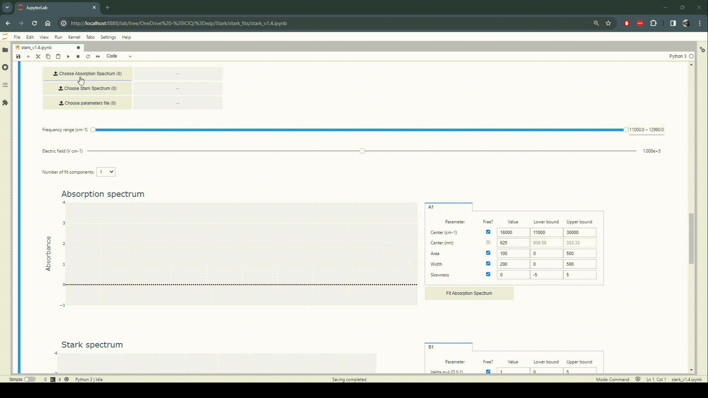

# lipstark
A tool to fit Stark spectra using Liptay's formalism.

# Installation
The notebook runs on `JupyterLab` and leans heavily on `ipywidgets` (for the UI) and on `plotly` (to display the spectra). Their different versions don't play along very nicely. This version was tested with the JupyterLab extension `jupyterlab-plotly@4.14.3`, plus the following Python libraries (installable with `pip`):

```
jupyterlab-3.0.11
plotly-4.12.0
ipywidgets-7.6.3
ipyfilechooser-0.4.3
lmfit-1.2.2
pandas-1.2.3
PyPDF2-1.26.0
fpdf-1.7.2
```

A packed `conda` environment is available upon request to simplify installation.

# Practical considerations
* To use the program you need the absorption and Stark spectra in separate files. Each file should consist of two columns, separated by spaces or tabs. The first column should contain the wavelengths in nm, while the second column should contain the absorbance or delta absorbance values. Please note that the program automatically converts wavelengths into frequencies (in wavenumbers).
* The only additional experimental information needed is the electric field value. There is a slider to select it, in $V cm^{-1}$.
* The typical workflow is as follows:
  1. Load the absorption and Stark spectra from their respective files.
  2. Using the respective slider, select the frequency range in which you are intersted.
  3. Using the respective slider, select the field value at which the experiment was performed.
  4. Select the number of components with which to fit the absorption spectrum.
  5. Give reasonable estimates for the parameters that define each peak, and for their lower and upper bounds.
  6. Click "Fit Absorption Spectrum", wait for the result to come up. Note that information on the fitting procedure will be printed in the log area, such as uncertainties or warnings (if any).
  7. If necessary, go back to point 5, until you are happy with the fit to the absorption spectrum.
  8. Give reasonable estimates for $Tr(\Delta \alpha)$ and $|\Delta \mu|$.
  9. Click "Fit Stark Spectrum", wait for the result to come up.
  10. If necessary, go back to point 8, until you are happy with the fit to the Stark spectrum.
  11. Once you have finished fitting, you can save a file containing all parameters, that can be reloaded in the future to continue working. You can also save all spectra in text format, and a report in PDF format containing all relevant information.
* As with any fit, it's better to start small, leaving only a few parameters free, and slowly adding more. For instance, when fitting the absorption spectrum, it may be a good idea to perform a first fit leaving only the peak centers and amplitudes free. Then, you can perform a second fit including now the widths as fit parameters, and maybe a third fit with skewnesses free as well.
* Similarly, the success of the fit depends quite strongly on how good the initial guess is. If you are having problems to fit, it's probably a good idea to play around with the parameters so that your guess reasonably resembles the experimental spectrum.
* Most of the actions (such as loading files or fitting spectra) are recorded in the log area. If you experience a problem or unexpected behavior, it might be a good idea to check it for error messages.

# Example use


